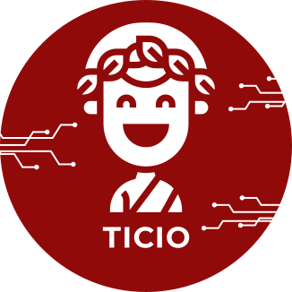
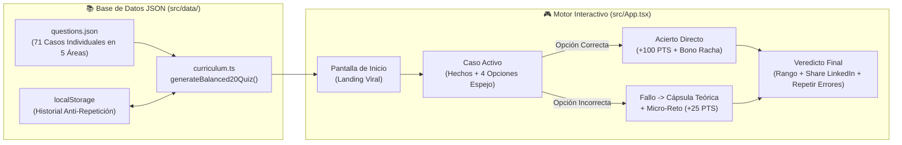

<div align="center">



# ⚖️ ¿Podrías ser un Abogado en Colombia? (`TicioReto`)

**El reto viral e interactivo de casos jurídicos reales inspirado en el Examen de Estado para Abogados (Ley 1905 de 2018).**

[](https://react.dev/)
[](https://www.typescriptlang.org/)
[](https://vite.dev/)
[](https://tailwindcss.com/)
[](./.github/workflows/deploy.yml)
[](https://opensource.org/licenses/MIT)

</div>

---

## 🎯 ¿Qué es este proyecto?

En Colombia, graduarse de Derecho ya no es suficiente para litigar: la **Ley 1905 de 2018** exige aprobar el Examen de Estado para obtener la Tarjeta Profesional.

**¿Podrías ser un Abogado en Colombia?** es una aplicación web estática (*Single Page Application* 100% client-side) con estética **Neo-Brutalista** (inspirada en el sistema visual de **Ticio**) y mecánicas de aprendizaje activo al estilo *Brilliant / Duolingo*:

- 🎲 **Banco JSON de 71 Casos Reales (1 Caso por Pregunta) + Memoria Anti-Repetición**: Toda la base de conocimiento se carga desde un único archivo [`src/data/questions.json`](./src/data/questions.json) con **71 expedientes individuales** distribuidos en las 5 grandes áreas del derecho. En cada partida selecciona **4 casos por área (20 en total)**, priorizando preguntas que aún no has visto en partidas recientes (`localStorage`) y barajando la posición de las opciones (`A`, `B`, `C`, `D`).
- 📋 **Caso Completo Siempre Visible**: Todo el supuesto de hecho está a la vista mientras tomas tu decisión legal, con distractores simétricos de igual longitud y rigor técnico donde solo cambia el elemento jurídico de fondo.
- ⚡ **Just-in-Time Learning (Teoría solo cuando fallas)**:
  - Si **aciertas**, sumas puntos con multiplicador de racha y avanzas directo al siguiente caso.
  - Si **fallas**, se activa al instante una cápsula de jurisprudencia y ley con el *Truco Legal* y un **micro-reto de comprobación** que debes superar para continuar (recuperando `+25 PTS`).
- 🏆 **Sistema de Puntos, Rachas y Veredictos Virales**:
  - `90% – 100%` → **GENIO DE LAS LEYES** (*¡Sí podrías ser abogado en Colombia y de los peligrosos!*)
  - `70% – 89%` → **AVANZADO · APROBADO CON TARJETA EN MANO** (*¡Sí podrías ser abogado en Colombia!*)
  - `50% – 69%` → **CASI ABOGADO · TE FALTÓ UN PELO PROCESAL** (*Sobrevives al pleito, pero te vencen los términos*)
  - `< 50%` → **ABOGADO DE TIKTOK · PELIGRO EN EL JUZGADO** (*No podrías ser abogado en Colombia todavía*)
- 🔗 **Compartir en LinkedIn en 1 Clic**: Genera tu tarjeta de veredicto con puntaje, precisión y mejor racha lista para publicar en LinkedIn.

---

## 🏗️ Arquitectura del Proyecto

El proyecto está diseñado para funcionar como una **SPA 100% estática**, sin necesidad de backend ni bases de datos externas, lo que permite alojarlo gratuitamente en **GitHub Pages**, Vercel, Netlify o Cloudflare Pages. Toda la información de casos, opciones, retroalimentación, cápsulas teóricas y micro-retos vive en [`src/data/questions.json`](./src/data/questions.json).



### 📂 Estructura de Directorios

```text
TestPrep/
├── .github/
│   └── workflows/
│       └── deploy.yml                # CI/CD automático para publicar en GitHub Pages
├── public/
│   └── Branding/                     # Logos e isotipo oficial de Ticio (SVG/PNG)
├── src/
│   ├── data/
│   │   ├── questions.json            # 🗂️ Fuente única de verdad (JSON) con los 71 casos jurídicos individuales
│   │   └── curriculum.ts             # Motor de muestreo balanceado (4x5=20), filtro anti-repetición y barajado A/B/C/D
│   ├── App.tsx                       # Máquina de estados del juego, sistema de puntos/rachas y UI
│   ├── index.css                     # Sistema de diseño Neo-Brutalista Ticio (sombras duras, bordes 3px)
│   ├── main.tsx                      # Punto de entrada de React 18
│   └── types.ts                      # Contratos TypeScript para preguntas, lecciones y micro-retos
├── index.html                        # Plantilla HTML con fuentes Poppins + Inter
├── package.json                      # Scripts y dependencias del proyecto
├── tsconfig.json                     # Configuración de TypeScript (con resolveJsonModule activado)
└── vite.config.ts                    # Configuración de Vite con base './' para rutas relativas en GH Pages
```

---

## 📦 Dependencias y Stack Tecnológico

El proyecto mantiene un árbol de dependencias ultraligero para garantizar tiempos de carga instantáneos:

### Dependencias de Producción (`dependencies`)
| Paquete | Versión | Propósito |
| :--- | :--- | :--- |
| [`react`](https://react.dev/) / [`react-dom`](https://react.dev/) | `^18.3.1` | Renderizado declarativo de la interfaz y manejo de estados del simulacro. |
| [`lucide-react`](https://lucide.dev/) | `^0.460.0` | Iconografía vectorial limpia y consistente con el estilo neo-brutalista. |
| [`canvas-confetti`](https://github.com/catdad/canvas-confetti) | `^1.9.3` | Efecto de celebración visual al culminar los 20 casos del reto. |

### Dependencias de Desarrollo (`devDependencies`)
| Paquete | Versión | Propósito |
| :--- | :--- | :--- |
| [`vite`](https://vite.dev/) + `@vitejs/plugin-react` | `^6.0.1` | Servidor de desarrollo con HMR instantáneo y empaquetador de producción. |
| [`tailwindcss`](https://tailwindcss.com/) + `@tailwindcss/vite` | `^4.0.0` | Motor de utilidades CSS de última generación integrado directamente en Vite. |
| [`typescript`](https://www.typescriptlang.org/) | `~5.6.2` | Tipado estático de extremo a extremo para los bancos de casos y opciones. |

---

## 🚀 Quickstart (Inicio Rápido)

Sigue estos pasos para correr el proyecto localmente en menos de 1 minuto:

### 1. Prerrequisitos
- **Node.js** `>= 18.x` (recomendado `20 LTS`)
- **npm** `>= 9.x`

### 2. Clonar e instalar dependencias

```bash
# Clona el repositorio
git clone https://github.com/tu-usuario/TestPrep.git
cd TestPrep

# Instala las dependencias
npm install
```

### 3. Ejecutar en modo desarrollo

```bash
npm run dev
```
Abre tu navegador en `http://localhost:5173` para jugar y probar cambios en tiempo real.

### 4. Compilar para producción

```bash
npm run build
npm run preview
```
Esto generará la carpeta estática `dist/` optimizada con rutas relativas (`base: './'`), lista para subirse a cualquier servidor estático o **GitHub Pages**.

---

## ➕ ¿Cómo agregar preguntas nuevas? (Guía paso a paso con `questions.json`)

¡No necesitas tocar ni una sola línea de código de React o TypeScript para agregar más casos al simulador! Toda la información del juego se carga dinámicamente desde el archivo [`src/data/questions.json`](./src/data/questions.json).

### Paso 1: Abre el archivo de datos
Abre [`src/data/questions.json`](./src/data/questions.json) en tu editor de código. Verás un arreglo JSON (`[ ... ]`) donde cada objeto representa un caso completo.

### Paso 2: Elige el `moduleId` (Área del Derecho)
Para que el motor de selección balanceada (`4 preguntas × 5 áreas = 20 preguntas`) incluya tu pregunta automáticamente, asigna uno de los 5 identificadores oficiales en el campo `"moduleId"`:
- `"constitucional"` → Derecho Constitucional, Tutela y Acciones Constitucionales.
- `"civil"` → Derecho Civil, Personas, Bienes, Sucesiones y Familia.
- `"comercial"` → Derecho Comercial, Societario (S.A.S.), Competencia, Propiedad Industrial y Títulos Valores.
- `"negocio"` → Negocio Jurídico, Obligaciones, Contratos y Responsabilidad Civil.
- `"guia"` → Derecho Procesal, Penal, Contencioso Administrativo, Laboral y Ética del Abogado.

### Paso 3: Agrega tu nuevo objeto JSON al arreglo
Copia la siguiente plantilla al final del arreglo en [`src/data/questions.json`](./src/data/questions.json) (recuerda poner una coma `,` después del objeto anterior):

```json
{
  "id": "com-13",
  "moduleId": "comercial",
  "unitId": "com-u1",
  "title": "Abuso del Derecho de Voto en S.A.S.",
  "difficulty": "Intermedio",
  "xpReward": 35,
  "norma": "Art. 43 Ley 1258 de 2008 y Art. 24 CGP",
  "lessonCard": {
    "title": "Abuso del Derecho de Voto (Mayoría, Paridad o Minoría)",
    "norma": "Art. 43 Ley 1258 de 2008",
    "summary": "Los accionistas deben ejercer el derecho de voto en interés de la compañía. Se considera abusivo el voto ejercido con el propósito de causar daño a la sociedad o a otros accionistas, o de obtener para sí o para un tercero una ventaja injustificada.",
    "keyPoints": [
      "Aplica tanto para abuso de mayoría como de paridad o de minoría.",
      "Puede dar lugar a la nulidad absoluta de la determinación adoptada y a la indemnización de perjuicios.",
      "Se tramita mediante proceso verbal sumario ante la Superintendencia de Sociedades."
    ],
    "analogyOrTip": "El Truco Legal: El bloqueo caprichoso de un minoritario con derecho a veto ('abuso de minoría') también es sancionable con nulidad e indemnización ante la Supersociedades."
  },
  "caseText": "En una S.A.S. donde los estatutos exigen unanimidad para reformar el objeto social, un accionista con el 10% bloquea sistemáticamente una reforma vital para salvar la empresa, exigiendo a cambio que los demás socios le compren sus acciones al triple de su valor comercial.",
  "questionText": "¿Qué acción judicial procede ante este bloqueo del accionista minoritario?",
  "options": [
    {
      "id": "A",
      "text": "Es procedente demandar por abuso del derecho de voto de minoría ante la Superintendencia de Sociedades para solicitar la nulidad de la decisión e indemnización de perjuicios.",
      "feedback": "¡Exacto! El Art. 43 de la Ley 1258 sanciona también el abuso de minoría o paridad cuando se usa el veto para obtener ventajas injustificadas."
    },
    {
      "id": "B",
      "text": "Es improcedente demandar por abuso del derecho de voto porque esta figura legal solo sanciona a los bloques mayoritarios que oprimen a los socios minoritarios de la compañía.",
      "feedback": "Falso. La Ley 1258 de 2008 contempla expresamente el abuso de mayoría, de paridad y también de minoría."
    },
    {
      "id": "C",
      "text": "Es procedente solicitar al alcalde municipal la exclusión administrativa inmediata del socio minoritario sin necesidad de agotar proceso jurisdiccional ni probar perjuicios.",
      "feedback": "Incorrecto. La controversia societaria es jurisdiccional ante la Superintendencia de Sociedades o jueces civiles, nunca ante la alcaldía."
    },
    {
      "id": "D",
      "text": "Es improcedente cuestionar el sentido del voto del accionista porque el derecho de propiedad sobre las acciones otorga una facultad absoluta e inmune a cualquier control judicial.",
      "feedback": "Incorrecto. Ningún derecho es absoluto; el voto debe ejercerse de buena fe y en interés de la sociedad (Art. 43 Ley 1258/08)."
    }
  ],
  "correctOptionId": "A",
  "legalExplanation": "Conforme al artículo 43 de la Ley 1258 de 2008, el abuso del derecho de voto puede ser cometido por mayorías, paridades o minorías con poder de bloqueo.",
  "remediation": {
    "prompt": "Si un socio usa su voto para causar daño u obtener ventaja injustificada, ¿ante quién se demanda la nulidad e indemnización?",
    "type": "multiple_choice",
    "options": [
      { "id": "op1", "text": "Ante la Superintendencia de Sociedades (funciones jurisdiccionales)." },
      { "id": "op2", "text": "Únicamente ante la Fiscalía General por delito societario." },
      { "id": "op3", "text": "No existe acción porque el voto es libre e incuestionable." }
    ],
    "correctId": "op1",
    "explanation": "La Superintendencia de Sociedades conoce del proceso verbal sumario por abuso del derecho de voto (Art. 43 Ley 1258/08 y Art. 24 CGP)."
  }
}
```

### 💡 Reglas de Oro para redactar buenas preguntas
1. **Simetría en las 4 opciones (`options`)**: Evita que la respuesta correcta sea obvia por ser la más larga o detallada. Las opciones `A`, `B`, `C` y `D` deben tener **la misma estructura gramatical y extensión**, cambiando únicamente la tesis o condición jurídica que hace verdadera o falsa cada alternativa.
2. **No te preocupes por la letra correcta**: Puedes dejar siempre `"correctOptionId": "A"` o `"B"` al redactar; la función `randomizeQuestionOptions()` en [`src/data/curriculum.ts`](./src/data/curriculum.ts) mezcla automáticamente el orden de las opciones en cada partida y reasigna las letras `A`, `B`, `C` y `D`.
3. **Teoría orientada al error (`lessonCard` y `remediation`)**: Recuerda que el jugador solo verá `lessonCard` y `remediation` si se equivoca en la pregunta principal. Escribe el campo `analogyOrTip` como un "Truco Legal" corto y memorable.
4. **Verifica el formato JSON**: Ejecuta `npm run build` antes de abrir tu *Pull Request* para asegurarte de que el JSON sea válido y cumpla con el esquema TypeScript.

---

## 🌐 Despliegue Automático en GitHub Pages

El repositorio ya incluye el workflow [`.github/workflows/deploy.yml`](./.github/workflows/deploy.yml).
Para activarlo en tu fork o repositorio:
1. Ve a **Settings → Pages** en tu repositorio de GitHub.
2. En **Build and deployment → Source**, selecciona **GitHub Actions**.
3. Haz `git push` a la rama `main` y tu app se publicará automáticamente.

---

## 📄 Licencia

Distribuido bajo la licencia **MIT**. Libre para usar, estudiar, compartir y mejorar.
